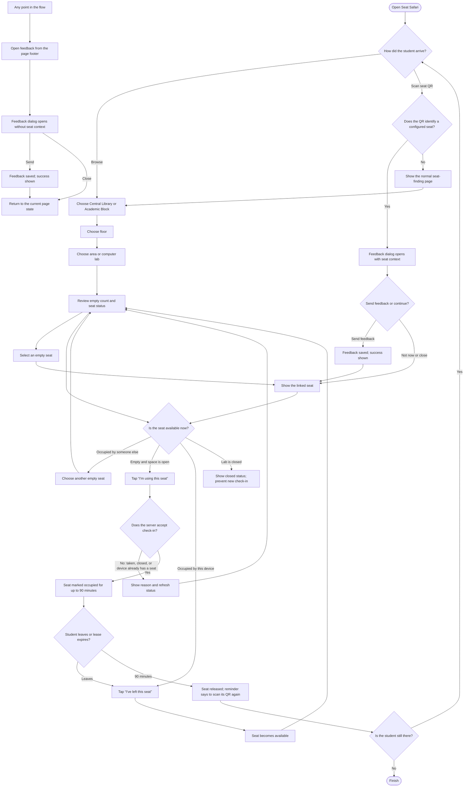

# Seat Safari user-flow diagram

## Scope

Seat Safari helps students find and self-report currently empty seats in the Central Library and Academic Block computer labs. It does not reserve seats. Check-ins expire after 90 minutes, and Academic Block labs close at 7:00 PM.

## Flow

## Notes

- Occupancy is self-reported. A printed QR code selects a seat but does not verify physical presence.
- A valid QR link opens the feedback dialog before showing the seat controls. Students can close it and continue.
- An expired seat must be scanned again before a student can mark it occupied again.
- Central Library area splits on Floors 2, 4, and 5 are provisional until actual per-area counts are confirmed.
